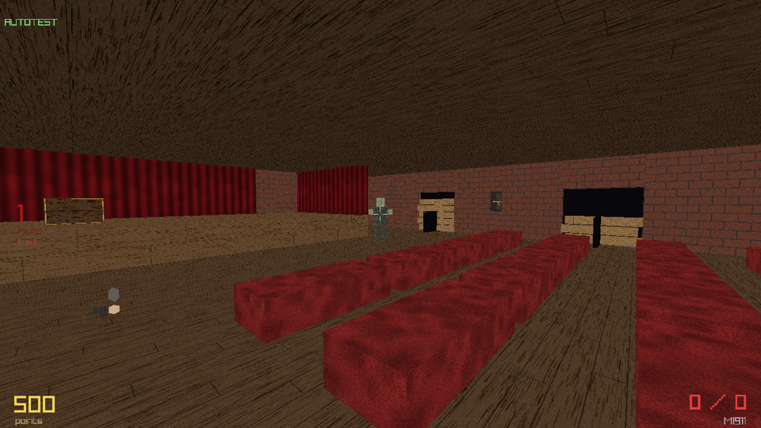
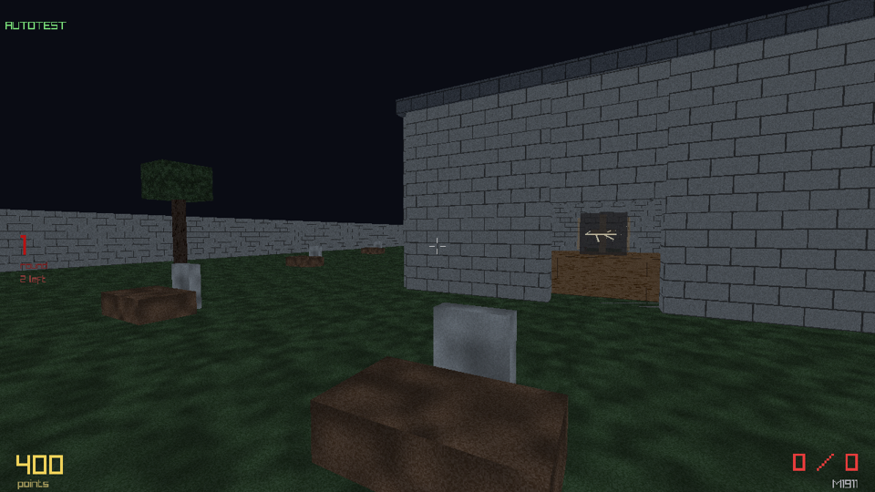
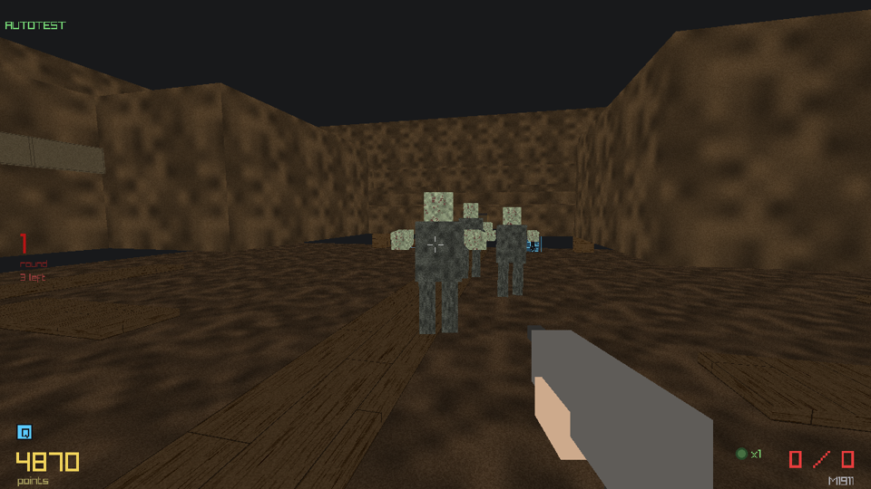

# Dead Arrival

**A round-based survival first-person shooter inspired by the classic Nazi Zombies mode.**
You are alone. Board up the windows, buy weapons off the walls, gamble at the mystery box,
and survive as many rounds as the horde allows.

> Dead Arrival is a free fan project. It is **not** published (or ever planned to be published)
> on Steam or any other store. It is built with [raylib](https://www.raylib.com) **6.2** in
> plain C99 — no engine, no wrappers.
>
> **This repository is in active development on the `dev` branch.** There are no version
> numbers yet — the first tagged release (GitHub Releases only) will appear once the game
> is polished enough. What you build from `dev` is a development snapshot.





## Features

- **Round-based survival** — endless rounds, growing hordes, walkers turn into runners
- **3 maps**, all plain data files (drop a new `.map` in `assets/maps` and it appears in the menu):
  - **Theater of the Damned** — a ruined playhouse. You start backstage and buy your way through doors into the auditorium, lobby and dressing rooms; zombies come through the boarded windows of whichever room you're in
  - **St. Aldric's Rest** — a graveyard with a church in the middle; zombies rise straight out of the grave mounds
  - **Hollow Line** — an open great-war trench network with two deep bunkers. There is no way up to the parapets: the horde drops in from above
- **23 weapons** defined in `assets/weapons.cfg` — pistols, SMGs, rifles, shotguns, LMGs and
  box-only specials; only some are wall-buyable
- **Perks, Pack-a-Punch, grenades** — Quick Revive / Double Tap / Speed Cola / Juggernog
  machines, a 5000-point Pack-a-Punch that upgrades your gun (2.5x damage, +50% mag),
  throwable grenades (G) with wall-buy refills, and a knife (V) with a proper viewmodel
- **Buyable doors and rooms** — maps can gate areas behind doors; zombie spawning follows
  the room you're in
- **Pathfinding horde** — zombies navigate with a walkability grid + BFS flow field
  (`src/nav.c`): they route around walls, down trenches and through doorways instead of
  grinding into the first obstacle, beeline when they can see you, and slide along walls
  to round corners
- **Classic economy** — 10 points per hit, 50 per kill, 10 per board repaired;
  wall buys and the **950-point mystery box**
- **All content is data-driven** — maps, weapon stats, textures and sounds load from `assets/`
  at runtime; nothing is baked into the binary
- **Procedural assets** — every texture and sound is generated by `tools/gen_assets.py`
  (no copyrighted material anywhere)

### Roadmap

| Feature | Status |
| --- | --- |
| Multiplayer | **COMING SOON** |
| Custom skins | **COMING SOON** |
| Custom maps (in-game editor) | **PLANNED** — the data format already works, see `docs/MAP_FORMAT.md` |

## Controls

| Input | Action |
| --- | --- |
| WASD | Move (Shift to sprint) |
| Mouse | Look / Left click fire / Right click aim |
| Space | Jump |
| R | Reload |
| 1 / 2 / Q | Switch weapon |
| F | Interact (buy, mystery box, doors, perks, Pack-a-Punch, rebuild boards) |
| V | Knife |
| G | Throw grenade |
| Esc | Pause |

## Building

You need a C compiler, git, and Python 3 (only to regenerate assets — they are committed).
On Linux install the usual X11/GL dev packages, e.g. on Debian/Ubuntu:

```sh
sudo apt install build-essential git python3 \
    libasound2-dev libx11-dev libxcursor-dev libxi-dev \
    libxinerama-dev libxrandr-dev libgl-dev
```

### Option A: plain Make (recommended)

```sh
make deps   # fetches raylib 6.2 and builds the static library (once)
make        # builds build/dead_arrival
./build/dead_arrival
```

**Already have raylib 6.2+ installed system-wide?** You don't need `make deps`:
the Makefile checks for a system raylib (via `pkg-config`, then the standard
`/usr[/local]` prefixes) and uses it automatically — the bundled copy is only
built when no compatible 6.2+ system install exists. Force a specific one with
`make RAYLIB_MODE=bundled` (or `system-pkgconfig` / `system-header`).
CMake behaves the same way (`find_package(raylib 6.2)` first, FetchContent fallback).

### Option B: CMake

```sh
cmake -B build -DCMAKE_BUILD_TYPE=Release
cmake --build build -j
./build/dead_arrival
```

Run the game from the repository root so the `assets/` folder is found.
On Windows, CMake + the VS developer tools work out of the box (raylib is fetched automatically).

### Display backends on Linux (X11 / Wayland)

The default build uses the X11 backend, which runs everywhere — including
Wayland desktops through XWayland. If you want a **native Wayland** build
(experimental):

```sh
sudo apt install libwayland-dev wayland-protocols libxkbcommon-dev
make deps RAYLIB_WAYLAND=1     # rebuilds raylib with the Wayland backend
make RAYLIB_WAYLAND=1
```

Linux is the primary platform; Windows and macOS compile in CI but are less
tested.

### Headless regression tests

The game has built-in self-tests used by CI:

```sh
xvfb-run -a ./build/dead_arrival --autotest theater.map 1800 out.png   # scripted session
xvfb-run -a ./build/dead_arrival --pathtest theater.map 60 out.png     # zombie reachability
./build/dead_arrival --list-maps
```

`--pathtest` freezes the round flow, places one zombie at every spawn point /
barrier (doors open, boards pre-torn) and verifies that every one of them
path-finds its way to the player — the regression test for the navigation
system (grid + BFS flow field in `src/nav.c`).

## Project layout

```
src/            C99 sources (game.h is the single shared header)
assets/
  maps/         .map files — every file here shows up in the map menu
  weapons.cfg   all weapon stats
  textures/     PNG textures (procedurally generated)
  sounds/       WAV sounds (procedurally generated)
tools/
  gen_assets.py regenerates every texture and sound from scratch
docs/
  MAP_FORMAT.md the map file format specification
  MODDING.md    how to add weapons, maps, textures and sounds
```

## Modding

Everything gameplay-related is data:

- New **map**: copy `assets/maps/theater.map`, edit it (see `docs/MAP_FORMAT.md`), restart the game.
- New **weapon**: add a `[weapon.your_gun]` block to `assets/weapons.cfg` — it is instantly
  placeable as a wall buy and can come out of the mystery box.
- New **texture/sound**: drop a PNG/WAV into `assets/textures` / `assets/sounds` and reference
  it by filename.

See `docs/MODDING.md` for the full guides.

## License

MIT — see [LICENSE](LICENSE). raylib is licensed under zlib (see the raylib repository).
"Dead Arrival" is an original fan work inspired by round-based zombie survival modes;
it is not affiliated with, endorsed by, or connected to any commercial game.
